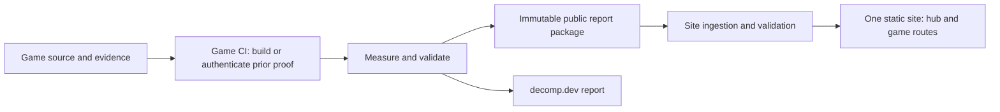

# Shared reporting architecture

Status: first NFL consumer adapter implemented. NFL’s existing producer workflow is unchanged. The broader data-store and multi-game migration below remain planned; portfolio Pages deployment is disabled.

The approved UI lives in this repository. Each game remains responsible for its build, measurements, source evidence and attribution. NFL Street 2 is the validation archetype; its compiler commands and evidence layout are not a universal template.

## Documents

- [NFL integration](nflstreet2.md): implemented commands, trust boundary, package format, module controls and rollout limits.

- [Pipeline audit](pipeline-audit.md): pinned source inspection of all three games.
- [Workflow](workflow.md): PR validation, main publication, recovery and site consumption.
- [Report contract](contract-v1.md): measurement semantics and modular features.
- [Migration plan](migration.md): rollout order and acceptance criteria.
- [Draft manifest schema](schema/report-v1.schema.json) and [project configuration schema](schema/project-v1.schema.json).
- [Synthetic manifest](examples/report.json) and [NFL configuration example](examples/project.json): documentation fixtures, not deployable data.

## Repository ownership

| Repository | Owns |
| --- | --- |
| `nflstreet2`, `mvp2005`, `tw2004` | Source, target/toolchain identity, build and comparisons, inventory, attribution evidence, durable measurement history, public report packages, decomp.dev compatibility exports |
| `mitsevox.github.io` | Shared UI and routes, project artwork/configuration, report schemas and shared validators, static site assembly and deployment |

Keep shared reporting tools in this site repository initially, version them, and have game adapters pin a reviewed commit. A fifth tooling repository is unnecessary now. Game-specific build logic stays in its game repository. Extract reusable validation/publication steps only after NFL works through the contract; do not copy three drifting implementations or replace proven validation with a generic workflow.

Future producer-store option: a data-only `progress-data` branch in each game repository, containing immutable snapshot packages and a latest-good pointer. Preserve existing archives during migration. The site fetches pinned packages during its build; visitors use the site's static files, not authenticated GitHub APIs. Start with manual/scheduled ingestion. Cross-repository dispatch is optional later and needs an explicitly scoped credential decision.

The frontend and wiki are published in `mitsevox/mitsevox.github.io`. GitHub Pages remains disabled until production report ingestion is verified. NFL Street 2 is the first integration; the other games follow once its implementation and onboarding documentation are validated.
